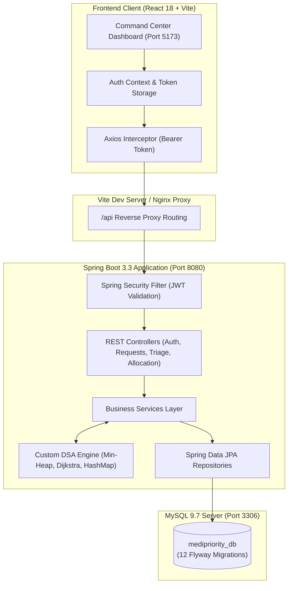

# 🏥 MediPriority — Intelligent Hospital Emergency Ambulance & Bed Allocation System

[](https://github.com/gouravgupta29092006-rgb/MediPriorty/actions)
[](https://openjdk.org/projects/jdk/21/)
[](https://spring.io/projects/spring-boot)
[](https://react.dev/)
[](https://www.typescriptlang.org/)
[](https://vitejs.dev/)
[](https://tailwindcss.com/)
[](https://www.mysql.com/)
[](LICENSE)

> A production-style, priority-driven clinical decision support and hospital resource allocation platform that replaces vulnerable First-Come, First-Served (FCFS) queuing with validated medical triage, custom Binary Min-Heap ordering, Dijkstra-powered ambulance pathfinding, and transaction-safe bed reservations.

---

## 1. Problem Statement

Conventional hospital emergency departments and ambulance dispatch networks often process incoming calls on a First-Come, First-Served (FCFS) or simple FIFO basis. In acute healthcare situations, this paradigm is clinically flawed:
- A non-critical patient (e.g., minor sprain) calling at 10:00 AM may monopolize the nearest Advanced Life Support (ALS) ambulance or hospital bed.
- A critical emergency patient (e.g., acute myocardial infarction or traumatic shock) calling at 10:03 AM faces dangerous dispatch delays.
- The outcome: preventable clinical deterioration, longer door-to-needle times, and increased mortality.

## 2. Proposed Solution

**MediPriority** solves emergency resource contention through a deterministic, priority-first software architecture:
1. **Mandatory Clinical Urgency Triage:** Certified medical officers evaluate and assign patients to internationally standardized triage levels: **RED** (Critical), **ORANGE** (High), **YELLOW** (Moderate), and **GREEN** (Low).
2. **From-Scratch Binary Min-Heap Priority Queue:** Triaged patients are dynamically ordered using a composite clinical score function factoring urgency weight and elapsed waiting time ($O(\log N)$ inserts and extracts).
3. **Dijkstra Shortest-Path Dispatching:** Custom graph pathfinding calculates optimal road transit times from EMS stations to emergency pickup zones.
4. **Concurrency-Safe Bed Allocations:** Atomic database transactions and optimistic/pessimistic state validation prevent simultaneous double-booking of scarce ICU and emergency beds.
5. **Auditable Governance:** An immutable audit ledger captures every sign-off, triage decision, dispatch event, and reservation.

---

## 3. Key Features

| Capability | Engineering Implementation |
| :--- | :--- |
| **Real-time Priority Queue** | Array-backed Binary Min-Heap ordering emergency patients by clinical priority score. |
| **Intelligent Ambulance Dispatch** | Capability matching (`BASIC`, `ADVANCED`, `NEONATAL`) with Dijkstra shortest road path. |
| **Hospital Bed Allocation** | Suitability matching (`GENERAL`, `EMERGENCY`, `ICU`) with database-level race condition prevention. |
| **Clinical Triage Sign-Off** | Role-restricted assessment with vital signs recording and multi-stage state transitions. |
| **Role-Based Access Control** | Stateless JWT authentication protecting routes across `ADMIN`, `DISPATCHER`, and `MEDICAL_OFFICER`. |
| **Immutable Audit Trail** | Automated system audit logging capturing actor, timestamp, client IP, action, and JSON payload. |
| **Operational Analytics** | Real-time distribution visualizations, full 6-status ambulance readiness, and real department bed metrics via Recharts. |
| **Healthcare UI/UX System** | Responsive 11-page command center styled with a healthcare teal palette, modernized clinical terminology, and light/dark theme support. |

---

## 4. Custom Data Structures & Complexity Analysis

MediPriority utilizes proprietary, from-scratch data structures implemented without relying on standard Java Collections inside algorithm kernels:

| Data Structure | Source File | Real-world Purpose | Time Complexity | Space Complexity |
| :--- | :--- | :--- | :--- | :--- |
| **Binary Min-Heap** | `PatientPriorityQueue.java` | Priority-first patient extraction | Insert: $O(\log N)$, Extract: $O(\log N)$, Peek: $O(1)$ | $O(N)$ contiguous array |
| **Custom HashMap** | `CustomHashMap.java` | Fast resource lookup with separate chaining | Avg: $O(1)$, Worst: $O(N)$ on high collision | $O(N + K)$ buckets |
| **Weighted Graph** | `RoadNetworkGraph.java` | Urban road network modeling | Vertex Add: $O(1)$, Edge Add: $O(1)$ | $O(V + E)$ adjacency list |
| **Dijkstra Algorithm** | `DijkstraAlgorithm.java` | Shortest path station-to-pickup routing | $O((V + E) \log V)$ with min-heap | $O(V)$ distance tracking |
| **Circular Queue** | `CircularQueue.java` | Fixed-size ring buffer for event dispatch | Enqueue: $O(1)$, Dequeue: $O(1)$ | $O(C)$ static buffer |
| **Merge Sort** | `MergeSort.java` | Stable ranking of vehicle candidates | Best/Avg/Worst: $O(N \log N)$ | $O(N)$ auxiliary space |

---

## 5. Technology Stack

### Backend
- **Core:** Java 21 LTS (Eclipse Adoptium)
- **Framework:** Spring Boot 3.3.5
- **Security:** Spring Security 6, Stateless JWT (HMAC-SHA256), BCrypt (Strength 12)
- **Persistence:** Spring Data JPA, Hibernate ORM 6
- **Database Migrations:** Flyway 10 (12 automated versioned SQL migrations)
- **Validation & Docs:** Jakarta Bean Validation, Springdoc OpenAPI 2.5 (Swagger UI)
- **Build Tool:** Maven Wrapper (`mvnw` / `mvnw.cmd`)

### Frontend
- **Framework:** React 18.3, TypeScript 5.5
- **Build Tool:** Vite 5.4
- **Routing:** React Router DOM v6
- **Styling:** Tailwind CSS 3.4, PostCSS, Lucide React Icons
- **Data Visualization:** Recharts, Lucide Icons
- **State & HTTP:** Axios Client with JWT Bearer Interceptors

### Database & Infrastructure
- **RDBMS:** MySQL 8.0+ / 9.x (InnoDB engine, utf8mb4 charset, strict ACID isolation)
- **CI/CD:** GitHub Actions (`.github/workflows/ci.yml`)

---

## 6. Architecture & System Flow



---

## 7. Quick Start & Installation

### 7.1 Prerequisites
- **Java 21 LTS** installed and verified (`java -version`).
- **Node.js 18+ LTS** and **npm** installed (`node -v`, `npm -v`).
- **MySQL 8.0+** running locally on port `3306`.
- **Git** version control.

### 7.2 Database Setup
1. Log into your local MySQL instance:
   ```powershell
   mysql -u root -p
   ```
2. Create the database and dedicated application user:
   ```sql
   CREATE DATABASE IF NOT EXISTS medipriority_db CHARACTER SET utf8mb4 COLLATE utf8mb4_unicode_ci;
   CREATE USER IF NOT EXISTS 'medipriority_user'@'localhost' IDENTIFIED BY 'changeme';
   GRANT ALL PRIVILEGES ON medipriority_db.* TO 'medipriority_user'@'localhost';
   FLUSH PRIVILEGES;
   ```

### 7.3 Backend Startup
1. Open PowerShell and navigate to the backend directory:
   ```powershell
   cd D:\JAVA\MediPriority\backend
   ```
2. Launch Spring Boot using the Maven Wrapper:
   ```powershell
   .\mvnw.cmd spring-boot:run
   ```
3. Flyway will automatically execute migrations `V1` through `V12` and seed demo accounts.
4. Backend API will listen on `http://localhost:8080`.

### 7.4 Frontend Startup
1. Open a new PowerShell terminal and navigate to the frontend directory:
   ```powershell
   cd D:\JAVA\MediPriority\frontend
   ```
2. Install dependencies:
   ```powershell
   npm install
   ```
3. Start the Vite development server:
   ```powershell
   npm run dev
   ```
4. Access the web application at **`http://localhost:5173`**.

---

## 8. Verified Demo Credentials

Use the **Quick Demo Credentials** buttons on the login screen to sign in instantly:

| Role | Email | Password | Scope & Primary Workflow |
| :--- | :--- | :--- | :--- |
| **System Administrator** | `admin@medipriority.com` | `Admin@123` | Full administrative control, user governance, system audit logs |
| **Chief Dispatcher** | `dispatcher@medipriority.com` | `Dispatch@123` | Patient registry, emergency calls, Dijkstra ambulance dispatch |
| **Medical Officer** | `doctor@medipriority.com` | `Doctor@123` | Clinical triage evaluations, hospital bed reservations |

---

## 9. Application URLs & Endpoints

| Resource | URL | Description |
| :--- | :--- | :--- |
| **Web Application** | [http://localhost:5173](http://localhost:5173) | React 18 single-page application |
| **Swagger UI** | [http://localhost:8080/swagger-ui/index.html](http://localhost:8080/swagger-ui/index.html) | Interactive OpenAPI documentation & test console |
| **OpenAPI 3.0 Spec** | [http://localhost:8080/api-docs](http://localhost:8080/api-docs) | Raw JSON API schema |
| **REST API Base** | [http://localhost:8080/api](http://localhost:8080/api) | Core application API endpoints |

---

## 10. Automated Testing & Verification

The project includes unit, service, concurrency, and security regression test suites:

### Run Backend Unit & Service Tests (31 Tests)
```powershell
cd D:\JAVA\MediPriority\backend
.\mvnw.cmd test
```
*Result: 31 tests run, 0 failures, 0 errors, 0 skipped.*

### Run Frontend Build & Typecheck
```powershell
cd D:\JAVA\MediPriority\frontend
npm run build
```
*Result: Clean compilation via `tsc && vite build` in ~9.5s.*

---

## 11. Project Directory Structure

```text
MediPriority/
├── .github/
│   └── workflows/
│       └── ci.yml               # GitHub Actions CI workflow
├── backend/
│   ├── src/
│   │   ├── main/java/com/medipriority/
│   │   │   ├── config/          # Spring Security, CORS, OpenAPI configs
│   │   │   ├── controller/      # REST API controllers
│   │   │   ├── dsa/             # From-scratch custom DSA implementations
│   │   │   ├── dto/             # Request & Response records
│   │   │   ├── exception/       # Global exception handling & error responses
│   │   │   ├── model/           # JPA database entities & enums
│   │   │   ├── repository/      # Spring Data JPA repositories
│   │   │   ├── security/        # JWT filter & UserDetailsService
│   │   │   └── service/         # Core business & allocation logic
│   │   └── resources/
│   │       ├── db/migration/    # Flyway versioned SQL scripts (V1 to V12)
│   │       └── application.yml  # Application properties
│   ├── src/test/java/           # JUnit 5 & Mockito test suite (43 tests)
│   ├── mvnw                     # Unix Maven Wrapper
│   ├── mvnw.cmd                 # Windows Maven Wrapper
│   └── pom.xml                  # Maven project descriptor
├── frontend/
│   ├── src/
│   │   ├── api/                 # Axios client with JWT interceptor
│   │   ├── components/          # Layout, Navigation, ProtectedRoute
│   │   ├── context/             # AuthContext, ThemeContext (Dark/Light)
│   │   ├── pages/               # 11 clinical command center pages
│   │   └── types/               # TypeScript interfaces & types
│   ├── index.html               # SPA HTML entry point
│   ├── package.json             # NPM package scripts & dependencies
│   ├── tailwind.config.js       # Design system theme configuration
│   └── vite.config.ts           # Vite build & proxy settings
├── docs/                        # Complete technical documentation suite (27 docs)
├── .env.example                 # Environment configuration template
├── .gitignore                   # Git exclusion rules
├── LICENSE                      # MIT Open Source License
└── README.md                    # Project documentation
```

---

## 12. Complete Documentation Index

All technical documents are maintained under [`docs/`](docs/):

- [`PROJECT_OVERVIEW.md`](docs/PROJECT_OVERVIEW.md) — Problem statement, goals, target audience, and scope.
- [`SRS.md`](docs/SRS.md) — Comprehensive Software Requirements Specification.
- [`PROJECT_PLAN.md`](docs/PROJECT_PLAN.md) — Development milestones, Gantt timeline, and deliverables.
- [`ARCHITECTURE.md`](docs/ARCHITECTURE.md) — Detailed layered architectural breakdown.
- [`TECH_STACK.md`](docs/TECH_STACK.md) — Detailed technology selections and rationale.
- [`DATABASE_SCHEMA.md`](docs/DATABASE_SCHEMA.md) — Complete table definitions, columns, and foreign keys.
- [`DATABASE_SETUP.md`](docs/DATABASE_SETUP.md) — MySQL installation, permissions, and Flyway migration steps.
- [`ER_DIAGRAM.md`](docs/ER_DIAGRAM.md) — Entity-relationship diagrams based on MySQL schema.
- [`UML_DIAGRAM.md`](docs/UML_DIAGRAM.md) — System class, sequence, and state machine diagrams.
- [`API_DOCUMENTATION.md`](docs/API_DOCUMENTATION.md) — Full REST endpoint catalog with JSON payloads.
- [`DSA_IMPLEMENTATION.md`](docs/DSA_IMPLEMENTATION.md) — In-depth analysis of custom data structures.
- [`DSA_COMPLEXITY_ANALYSIS.md`](docs/DSA_COMPLEXITY_ANALYSIS.md) — Asymptotic time and space complexity matrix.
- [`ALLOCATION_ALGORITHMS.md`](docs/ALLOCATION_ALGORITHMS.md) — Urgency score functions, Dijkstra routing, and bed matching.
- [`SECURITY.md`](docs/SECURITY.md) — Authentication, BCrypt hashing, JWT lifecycle, and defense strategies.
- [`TESTING_STRATEGY.md`](docs/TESTING_STRATEGY.md) — Quality assurance layers and test execution methodologies.
- [`TEST_CASES.md`](docs/TEST_CASES.md) — Catalog of 43 backend and 15 security regression test cases.
- [`ENVIRONMENT_SETUP.md`](docs/ENVIRONMENT_SETUP.md) — Windows and Linux prerequisite installation.
- [`DEPLOYMENT.md`](docs/DEPLOYMENT.md) — Production packaging, Nginx reverse proxy, and security checklist.
- [`DEMO_GUIDE.md`](docs/DEMO_GUIDE.md) — Step-by-step evaluator walkthrough script.
- [`KNOWN_LIMITATIONS.md`](docs/KNOWN_LIMITATIONS.md) — System scope boundaries and future enhancements.

---

## 13. License & Authorship

- **Author:** Gourav Kumar Gupta
- **License:** Distributed under the **MIT License**. See [`LICENSE`](LICENSE) for full details.
