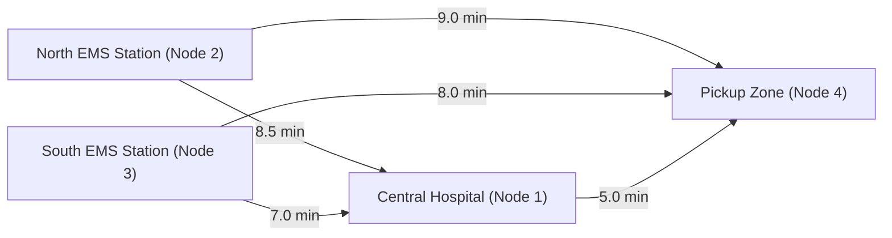

# MediPriority — Resource Allocation Algorithms

## 1. Urgency Scoring & Priority Engine

MediPriority addresses emergency queuing by replacing First-Come, First-Served (FCFS) with a multi-variable clinical urgency scoring algorithm evaluated continuously inside a custom Binary Min-Heap.

### 1.1 Priority Evaluation Function

For any triaged emergency request $i$, the dynamic composite priority score $P_i$ is determined by:

$$P_i = W_{\text{triage}}(C_i) - \lambda \cdot T_{\text{wait}}(i) + M_{\text{comorbidity}}(i)$$

Where:
- $W_{\text{triage}}(C_i)$ is the baseline clinical urgency weight:
  - **RED (Critical):** $1{,}000$ points
  - **ORANGE (High):** $750$ points
  - **YELLOW (Moderate):** $500$ points
  - **GREEN (Low):** $250$ points
- $T_{\text{wait}}(i)$ is the elapsed waiting time in minutes since request creation.
- $\lambda$ is the aging acceleration coefficient ($\lambda = 2.5\text{ pts/min}$), preventing clinical starvation of moderate cases.
- $M_{\text{comorbidity}}(i)$ is the clinical modifier score evaluated from recorded vital signs and patient history ($0$ to $+150$).

### 1.2 Binary Min-Heap Operations
- In an array-backed Min-Heap where the root represents the highest-priority patient:
  - **Insertion (`insert`):** Adds the emergency node at position $N$ and bubbles up (`siftUp`) in $O(\log N)$ comparisons.
  - **Extraction (`extractMin`):** Replaces root with node at $N$, decreases heap size, and bubbles down (`siftDown`) in $O(\log N)$ comparisons.
  - **Heap Peek (`peek`):** Returns the most critical waiting emergency in $O(1)$ time.

### 1.3 Emergency Lifecycle Eligibility & Eviction Predicate

To prevent discharged, admitted, or closed patients from lingering in the active allocation queue, eligibility is governed by a deterministic lifecycle predicate:

$$\text{Eligible}(r) \iff \text{status}(r) \in \{\text{TRIAGED}, \text{AMBULANCE\_DISPATCHED}, \text{ARRIVED}, \text{BED\_RESERVED}\} \land |\text{TriageRecords}(r)| \ge 1$$

- **Ineligible Terminals:** States $\text{CLOSED}$, $\text{ADMITTED}$, and $\text{CANCELLED}$ immediately invalidate the candidate node.
- **Database Synchronization:** On every `getOrderedQueue()` and `peekHighestPriority()` invocation, `PriorityQueueService` synchronizes with MySQL via `findQueueEligibleRequests()`. Stale nodes are purged lazily through the version registry or during scheduled heap rebuilds triggered by service lifecycle events.

---

## 2. Ambulance Pathfinding via Dijkstra's Algorithm

When a dispatcher initiates ambulance allocation for request $i$ at pickup node $v_{\text{pickup}}$:



### 2.1 Graph Formulation
- Urban transport topology is represented as a weighted, directed/bidirectional graph $G = (V, E, W)$, where:
  - $V$ is the set of road intersections, EMS stations, and hospital centers.
  - $E$ is the set of passable road segments.
  - $W: E \rightarrow \mathbb{R}^+$ represents estimated travel time in minutes (accounting for segment distance and urban speed limits).

### 2.2 Algorithm Procedure
1. Identify all available ambulances whose equipment level satisfies or exceeds request requirements ($\text{level}_{\text{amb}} \ge \text{level}_{\text{req}}$).
2. For each unique EMS station holding an available ambulance:
   - Run custom `DijkstraAlgorithm.findShortestPath(G, \text{stationNode}, v_{\text{pickup}})`.
   - Maintain a custom priority min-heap of active node distances $D[u]$.
   - Relax adjacent edges $(u, v)$ where:
     $$D[v] > D[u] + W(u, v)$$
3. The ambulance at the station with minimal travel time $T^* = \min \{ \text{dist}(\text{station}_k, v_{\text{pickup}}) \}$ is selected.

---

## 3. Hospital Bed Matching & Concurrency Safety

### 3.1 Clinical Suitability Rules

| Patient Triage Level | Primary Bed Target | Allowable Fallback |
| :--- | :--- | :--- |
| **RED (Critical)** | `ICU` | `EMERGENCY` (with immediate step-up protocol) |
| **ORANGE (High)** | `EMERGENCY` | `ICU` (if unassigned), `GENERAL` (monitored) |
| **YELLOW (Moderate)** | `GENERAL` | `EMERGENCY` |
| **GREEN (Low)** | `GENERAL` | Outpatient observation ward |

### 3.2 Concurrency & Transaction Control
- To prevent simultaneous double-booking of beds under high concurrency:
  1. Transaction isolation is set to `REPEATABLE_READ`.
  2. Spring Data JPA repository executes atomic state change:
     ```sql
     UPDATE hospital_beds 
     SET status = 'OCCUPIED', updated_at = NOW() 
     WHERE bed_id = :bedId AND status = 'AVAILABLE';
     ```
  3. If affected row count equals $0$, the system detects a race condition and throws `ResourceConflictException` mapped to HTTP 409 Conflict.
  4. The client receives an immediate response allowing alternative bed selection without database corruption or orphan reservations.

