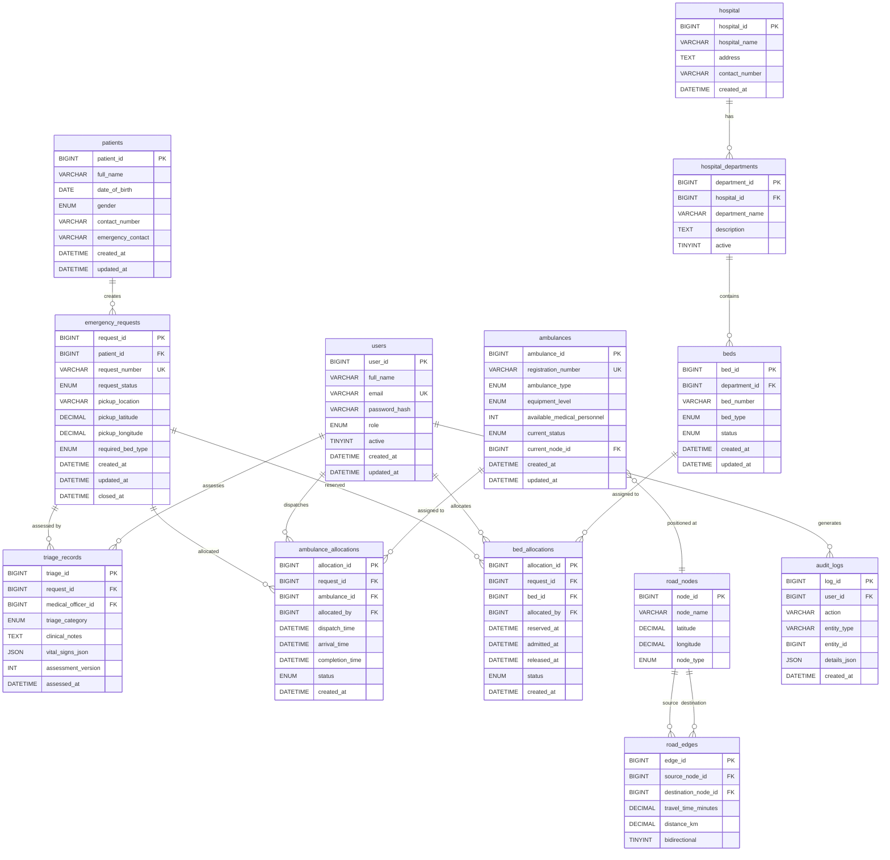

# ER DIAGRAM — MediPriority

## Entity Relationship Diagram

## Relationship Summary

| Relationship | Type | Notes |
|---|---|---|
| hospital → hospital_departments | 1:M | One hospital, many departments |
| hospital_departments → beds | 1:M | Beds belong to departments |
| patients → emergency_requests | 1:M | Patient may have multiple emergencies |
| emergency_requests → triage_records | 1:M | Multiple assessments per request |
| emergency_requests → ambulance_allocations | 1:M | Allocation history preserved |
| emergency_requests → bed_allocations | 1:M | Allocation history preserved |
| ambulances → ambulance_allocations | 1:M | Ambulance reused across time |
| beds → bed_allocations | 1:M | Bed reused across time |
| users → triage_records | 1:M | Officer assesses many patients |
| road_nodes → road_edges | 1:M | Each node may connect to many |
