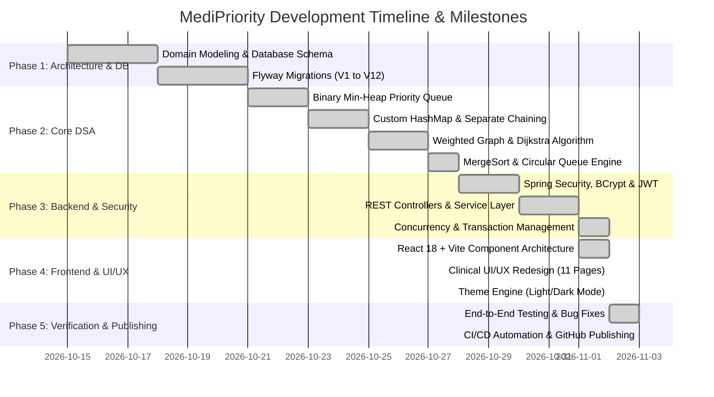

# MediPriority — Master Project Plan

## 1. Project Overview & Timeline

MediPriority was designed and developed across structured engineering phases to build a production-style, priority-based hospital emergency ambulance and bed allocation system.

---

## 2. Phase Deliverables & Work Breakdown

### Phase 1: Database Architecture & Domain Model
- Multi-table relational schema designed in MySQL 8/9.
- 12 incremental Flyway migrations guaranteeing referential integrity:
  - `V1__init_schema.sql` to `V12__seed_initial_data.sql`.
- Indexed lookup fields for email, status, triage category, and foreign keys.

### Phase 2: Custom Data Structures & Algorithms
- Implementation of 5 core from-scratch DSA structures (no Java Collections inside algorithms):
  1. `PatientPriorityQueue` (Array-backed Binary Min-Heap).
  2. `CustomHashMap` (Separate Chaining with dynamically resizing buckets).
  3. `RoadNetworkGraph` (Weighted adjacency-list graph representation).
  4. `DijkstraAlgorithm` (Shortest-path pathfinding using min-heap for priority node expansion).
  5. `MergeSort` & `CircularQueue` (Stable sorting and O(1) buffer streaming).

### Phase 3: Backend Services & API Layer
- Spring Boot 3.3.5 layered architecture:
  - Controllers $\rightarrow$ Services $\rightarrow$ Repositories $\rightarrow$ Entities $\rightarrow$ DTOs $\rightarrow$ Mappers.
- Stateless JWT authentication and BCrypt password encryption (strength 12).
- Global exception mapping and field-level validation using Jakarta Bean Validation.

### Phase 4: Frontend Command Center
- React 18 single-page application bundled with Vite.
- Tailwind CSS design system featuring healthcare teal (`#168F83`) palette.
- 11 dedicated functional pages matching clinical dashboard design specifications:
  - Command Center Login, Emergency Command Dashboard, Priority Queue, Patients Directory, Emergency Requests, Clinical Triage, Ambulance Fleet, Bed Management, Allocation History, Emergency Analytics, User Management, and Audit Logs.

### Phase 5: Testing, Hardening & Publishing
- 31 automated backend unit/service test cases.
- Comprehensive authentication regression test covering 15 scenarios.
- GitHub Actions CI workflow for automated Linux builds.
- Complete Markdown documentation suite under `docs/`.

---

## 3. Risk Management & Mitigations

| Identified Risk | Impact | Probability | Mitigation Strategy |
| :--- | :--- | :--- | :--- |
| **Simultaneous Resource Conflict** | Critical | High | Spring `@Transactional(isolation = Isolation.REPEATABLE_READ)` and optimistic locking with HTTP 409 status returns. |
| **Unauthorized Triage Override** | High | Medium | Role-based `@PreAuthorize("hasAnyRole('MEDICAL_OFFICER', 'ADMIN')")` at the service and method security boundary. |
| **Authentication Form Masking** | Medium | Medium | Pre-submission trimming, case-insensitive repository lookups, and granular error mapping for inactive accounts and network faults. |
| **Port Conflicts on Local Machine** | Low | Medium | Vite proxy forwarding `/api` requests to port `8080` with dynamic fallback origin pattern support. |
