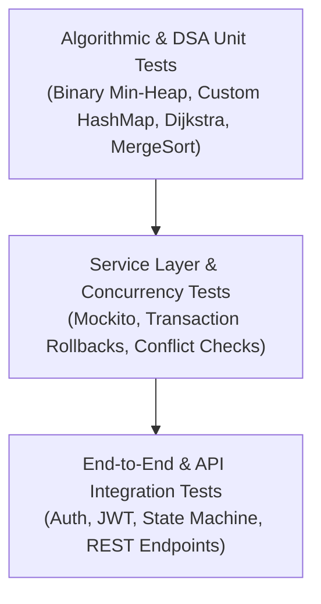

# MediPriority — Testing Strategy & Quality Assurance

## 1. Testing Philosophy & Scope

MediPriority adheres to an automated multi-layer testing strategy designed to verify algorithmic correctness, data integrity, security enforcement, and concurrency safety.



---

## 2. Test Layers

### 2.1 Layer 1: Custom DSA Unit Verification
- Direct, collection-independent unit tests for all custom data structures.
- **Test Classes:**
  - `PatientPriorityQueueTest`: Heap invariant maintenance, siftUp/siftDown correctness, edge cases (empty heap, single item, reverse-ordered inserts).
  - `CustomHashMapTest`: Collision resolution via separate chaining, dynamic threshold resizing, key eviction, null safety.
  - `DijkstraAlgorithmTest`: Non-negative edge pathfinding, unreachable node detection, multi-hop shortest paths.
  - `MergeSortTest`: Stability preservation across identical priority elements, array sorting.
  - `CircularQueueTest`: Fixed ring buffer wrapping, underflow/overflow bounds.

### 2.2 Layer 2: Service & Concurrency Testing
- Unit and mock testing of business rules using JUnit 5 and Mockito.
- **Test Classes:**
  - `AmbulanceAllocationServiceTest`: Equipment level filtering, optimal station selection, status transition to `DISPATCHED`.
  - `BedAllocationServiceTest`: Bed availability validation, concurrent allocation failure handling (`ResourceConflictException`), department association.
  - `TriageServiceTest`: Authorization enforcement, triage score calculation, queue insertion.

### 2.3 Layer 3: Security & Regression Testing
- Node.js automated test runner verifying:
  - Valid JWT generation and parsing across all 3 roles.
  - Case-insensitive email resolution.
  - Whitespace-padded input normalization.
  - Immediate HTTP 403 rejection for deactivated accounts.
  - Field error extraction on malformed inputs.
  - CORS preflight and allowed origin pattern support.

### 2.4 Layer 4: Frontend Build & Typecheck
- TypeScript strict mode compiler (`tsc --noEmit`).
- Production bundle verification via Vite (`npm run build`).

---

## 3. Test Execution Commands

### Backend Test Execution
```powershell
cd D:\JAVA\MediPriority\backend
# Run all unit and service tests:
.\mvnw.cmd test

# Run a specific test class:
.\mvnw.cmd test -Dtest=PatientPriorityQueueTest
```

### Frontend Build & Type Verification
```powershell
cd D:\JAVA\MediPriority\frontend
# Typecheck and production bundle build:
npm run build
```

